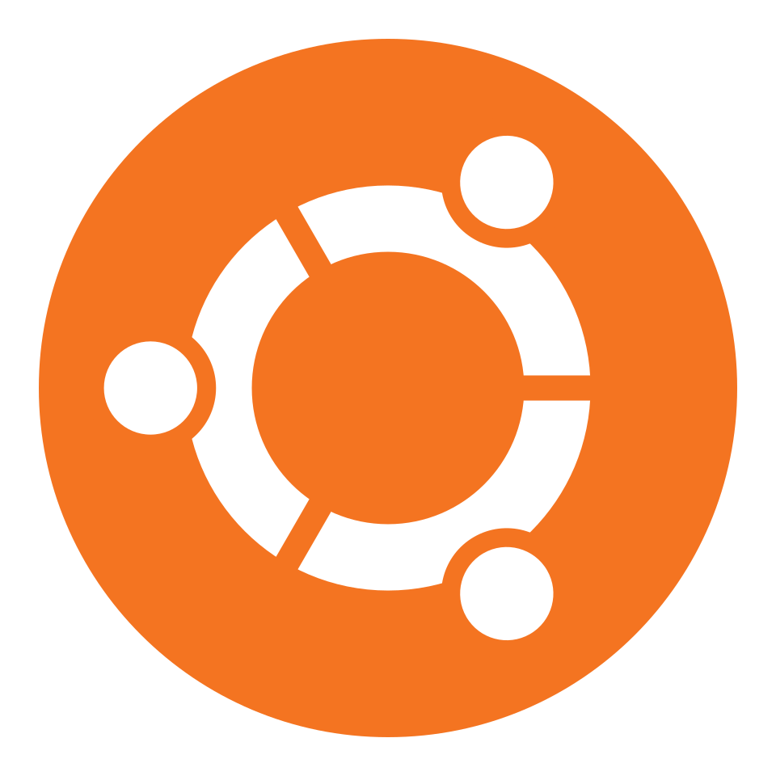
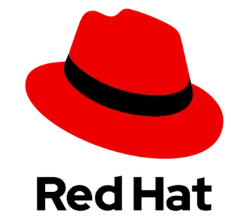
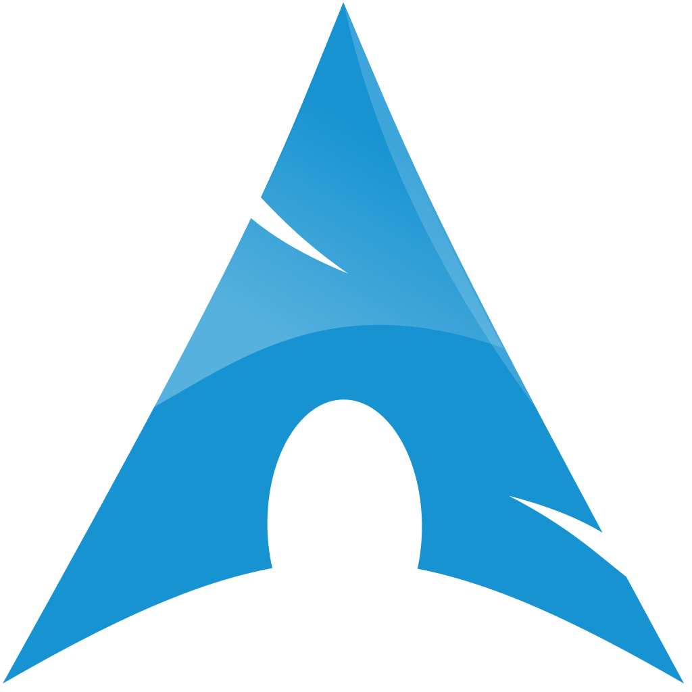
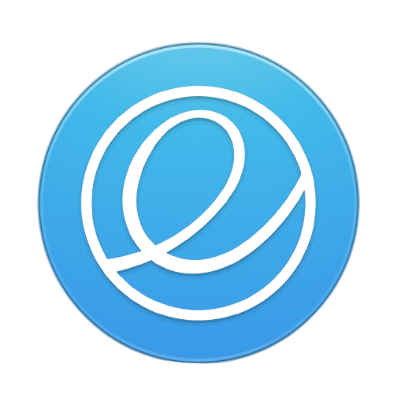

# How do you choose the right distribution?

This guide will help you choose a suitable distro for your computer. The selection is immense, and students are often overwhelmed by the number of distributions available.

To make the choice of operating system, you must consider design criteria. Unfortunately, it is impossible to satisfy everything. For personal use, you usually want a flexible system, while a bank would prefer a consistent system.

### 1. Consistency

The response of the OS should remain predictable.

- If I run the same command multiple times, do I get the same result each time?
- Does my system crash too often?

### 2. Flexibility

New versions of the OS should not usually break older applications.

- What can my operating system handle, and for what is it intended?
- Windows can do a lot, but a Raspberry Pi cannot.

### 3. Portability

The OS should run on different hardware.

- How easily can I share data between operating systems?

## Windows users and beginners

For some people, the transition to Linux is too large, and they do not want to make it completely. This can be easily resolved, because distributions such as Linux Mint and Zorin OS are extremely user-friendly both in installation and everyday use, which makes the learning curve when switching to Linux much less of an issue. These operating systems focus on the GUI and use the terminal only where necessary.

Although real Linux users often prefer to show off their skills with more difficult distributions, Linux Mint and Zorin OS are also popular with experienced Linux users: they are easy to set up and are often used as a substitute for Windows, but more efficiently and better.

### Linux Mint

Linux Mint is a user-friendly, stable distribution based on Ubuntu (or Debian for LMDE). It is known for its Cinnamon desktop, which strongly resembles the classic Windows interface.

- Interface: Classic Windows-like (Cinnamon)
- Ease of use: Very easy, everything works out of the box
- Performance: Light, especially the Xfce edition
- Software management: APT + Flatpak, no Snap
- Target audience: Users who want stability and simplicity

Choose Linux Mint if you want a classic Windows experience, maximum stability, and a no-nonsense desktop. Mint is less suitable if you want the latest software and maximum customizability.

### Zorin OS

Zorin OS is an Ubuntu LTS-based distribution explicitly designed to make moving from Windows as smooth as possible. It is not an experimental Linux distro, but a comfortable, modern, and visually polished desktop environment.

- Interface: Modern Windows-like (Zorin Desktop)
- Ease of use: Very simple, extra visual polish
- Performance: Very light, runs on older PCs
- Software management: Ubuntu software store + Flatpak
- Target audience: Windows switchers who want a modern look

> [!NOTE]
> Some features are only available in the paid edition (Zorin OS Pro). This requires a one-time payment to access the professional features, but the free version is more than sufficient.

Choose Zorin OS if you value a modern Windows look, Windows app compatibility, and a polished interface.

## Stability

### Debian

Debian is one of the oldest and most reliable Linux distributions still actively developed today. It is fully community-driven and known for its stability, predictability, and enormous software repositories.

- Interface: GNOME (classic and sober)
- Ease of use: Medium; technical but predictable
- Performance: Very stable, not cutting-edge
- Software management: APT, point release
- Target audience: Servers, stable desktops

You choose Debian when stability, reliability, and calm matter more than the latest features. It is ideal for systems that simply need to keep working: servers, homelabs, workstations, and minimal desktops.

### Ubuntu

Ubuntu is one of the most widely used and accessible Linux distributions in the world. It is built on Debian, but it focuses much more on ease of use, a modern desktop experience, and broad hardware support.

- Interface: GNOME with Ubuntu shell
- Ease of use: Very easy, lots of automation
- Performance: Good for workloads, gaming is fine
- Software management: APT + Snap, LTS + interim releases
- Target audience: Beginners, mainstream users

You choose Ubuntu when you want a stable, modern, and user-friendly Linux experience without hassle. It is ideal for beginners thanks to automatic hardware detection, clear settings, and a large community.

### Fedora

Fedora is a modern, forward-looking Linux distribution focused on new technology, innovation, and a pure GNOME experience. It is developed by the community with support from Red Hat, and often acts as the place where new Linux technologies first appear before later landing in enterprise systems.

- Interface: GNOME (stock, modern)
- Ease of use: Medium; technical but logical
- Performance: Cutting-edge, very good for workloads
- Software management: DNF, semi-rolling
- Target audience: Developers, power users

You choose Fedora when you want a modern, fast, and cutting-edge Linux experience that is still stable enough for daily use. Fedora is ideal for developers, power users, and anyone who likes working with the newest technologies such as Wayland, new kernels, modern GNOME versions, and container tools.

## Servers

### openSUSE

openSUSE is a professional, versatile Linux distribution developed by the openSUSE community in cooperation with SUSE, a major enterprise player. It comes in two variants: Leap (stable, enterprise-based) and Tumbleweed (rolling release, always up to date).

(Leap)

- Interface: KDE Plasma by default
- Ease of use: Medium; YaST helps a lot
- Performance: Very good; rolling release
- Software management: Zypper, rolling
- Target audience: Power users, sysadmins

(Tumbleweed)

- Interface: KDE Plasma by default
- Ease of use: Medium; enterprise feel
- Performance: Very stable, predictable
- Software management: Zypper, point release
- Target audience: Enterprise, stable desktops

You choose openSUSE when you want a powerful, professional, and flexible Linux distribution.
Leap is ideal for users who want a stable, enterprise-like base without the complexity of RHEL.

Tumbleweed is perfect for those who want a rolling release that remains reliable thanks to strict quality controls.

### RHEL (Red Hat Enterprise Linux)

RHEL is an enterprise-focused Linux distribution developed by Red Hat, one of the largest and most influential companies in the open-source world. It is designed for companies, organizations, and production environments where stability, security, predictability, and professional support are crucial.

- Interface: GNOME (enterprise style)
- Ease of use: Medium; professional, less desktop-focused
- Performance: Very stable, not cutting-edge
- Software management: DNF, point release
- Target audience: Businesses, production environments

You choose RHEL when you need a professional, stable, and long-term supported Linux platform suitable for business environments.

## Gaming

### Bazzite

Bazzite is a modern, gaming-focused Linux distribution built on Fedora’s immutable technology (rpm-ostree). It is designed to provide an experience that strongly resembles SteamOS, but is suitable for regular PCs, laptops, HTPCs, and even the Steam Deck.

- Interface: KDE (SteamOS-like)
- Ease of use: Very easy for gamers
- Performance: Very high; fully gaming-optimized
- Software management: rpm-ostree, immutable rolling
- Target audience: Gamers, Steam Deck/HTPC

You choose Bazzite when you want a SteamOS-like experience on hardware that is not a Steam Deck. It is ideal for gamers who want maximum performance without having to tinker with kernels, drivers, Proton versions, or game optimizations.

### Nobara

Nobara is a gaming-focused Linux distribution built on Fedora, but with all the optimizations that gamers normally have to install themselves already integrated. Instead of a “pure” Fedora experience, you get a ready-to-go gaming setup with custom kernels, extra repositories, improved compatibility, and tools ready for Steam, Lutris, Heroic, emulators, and streaming software.

- Interface: GNOME or KDE
- Ease of use: Very simple for gaming/streaming
- Performance: Very high; custom kernels, NVIDIA fixes
- Software management: DNF, semi-rolling
- Target audience: Gamers, streamers

You choose Nobara when you want a user-friendly, powerful, and fully optimized gaming experience without having to tinker with drivers, kernels, or compatibility layers yourself.

### POP!_OS

Pop!_OS is a user-friendly, modern Linux distribution developed by System76. It is based on Ubuntu, but focuses much more on productivity, creators, developers, and NVIDIA users.

- Interface: COSMIC (GNOME-derived)
- Ease of use: Very simple, productive
- Performance: Good; NVIDIA-friendly
- Software management: APT + Flatpak, Ubuntu LTS
- Target audience: Creators, developers

You choose Pop!_OS when you want a modern, productive, and hardware-friendly Linux experience that is less cluttered than Ubuntu and more focused on efficient work.

## Performance and customization

### Arch Linux

Arch Linux is a minimalist, rolling-release Linux distribution that you build entirely yourself. It provides an extremely light base without unnecessary software, so you can install exactly what you need.

- Interface: No default (DIY)
- Ease of use: Low; everything is manual
- Performance: Very high; cutting-edge
- Software management: Pacman + AUR, rolling
- Target audience: Power users, tweakers

You choose Arch when you want full control, maximum flexibility, and the newest software. Arch is ideal for power users who want to understand and configure their system precisely.

### CachyOS

CachyOS is an Arch-based distribution focused on maximum performance, especially for gaming and desktop use. It combines the flexibility of Arch with automatic optimizations such as advanced CPU schedulers, optimized kernels, performance profiles, and a user-friendly installer.

> [!TIP]
> There are several students in the IT lab who use CachyOS as their daily driver. If you need help with installation, you can definitely ask them!

- Interface: KDE Plasma (variable)
- Ease of use: Medium; the installer helps a lot
- Performance: Very high; performance kernels, gaming
- Software management: Pacman + AUR, rolling
- Target audience: Gamers, performance enthusiasts

You choose CachyOS when you want Arch flexibility without Arch difficulty, combined with top-tier performance for gaming and desktop use.

### NixOS

NixOS is a unique Linux distribution that revolves entirely around declarative configuration and the Nix package manager. Instead of manually changing settings, you describe your entire system in a single configuration file.

- Interface: No default (DIY)
- Ease of use: Low-medium; declarative thinking required
- Performance: High; reproducible and stable
- Software management: Nix, declarative, rolling
- Target audience: DevOps, configuration experts

You choose NixOS when you want full control, reproducibility, and safety.
It is ideal for developers, sysadmins, and power users who want to manage their system as code.

### Gentoo Linux

Gentoo is a source-based Linux distribution where you compile almost all software yourself. This allows you to fully optimize the system for your hardware and your needs.

- Interface: No default (DIY)
- Ease of use: Low; compile-based
- Performance: Very high; fully optimized
- Software management: Portage, rolling
- Target audience: Experts, performance purists

You choose Gentoo when you want absolute control and maximum optimization. Gentoo lets you build your system exactly as you want it, optimized for your CPU, your hardware, and your functionality.

## Design and aesthetics

### Deepin

Deepin is a Chinese Linux distribution known for its very modern, visually impressive, and user-friendly desktop environment: the Deepin Desktop Environment (DDE).

- Interface: Deepin Desktop (macOS-like)
- Ease of use: High; visually intuitive
- Performance: Medium; visually heavy
- Software management: APT, Debian-based
- Target audience: Beginners, visual users

You choose Deepin when you want a beautiful, modern, and highly user-friendly desktop that feels good immediately without requiring any tinkering.

### Elementary OS

Elementary OS is an elegant, minimalist Linux distribution based on Ubuntu, designed to provide a calm, consistent, and macOS-like user experience.

- Interface: Pantheon (macOS-like)
- Ease of use: High; minimalist and calm
- Performance: Medium; light desktop
- Software management: APT, Ubuntu LTS
- Target audience: Minimalists, macOS fans

You choose Elementary OS when you want a minimalistic, calm, and visually consistent desktop that is not full of options or distractions. It is ideal for users who want a macOS-like workflow, but on Linux and without complex configuration.
