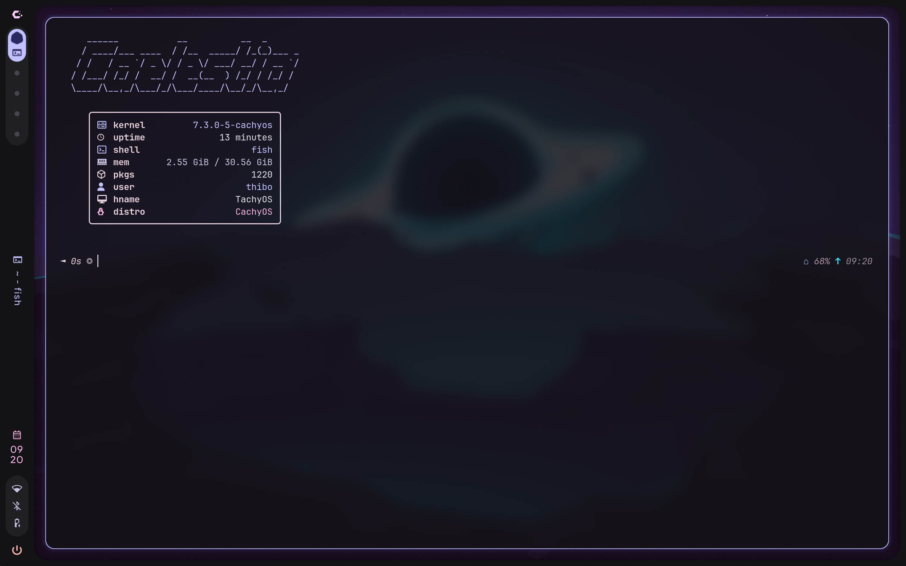

# Caelestia Shell

Caelestia is a shell for Hyprland, built with Quickshell. It includes the taskbar, launcher, notifications, settings, and other graphical components. It works on Arch-based distributions, including CachyOS.

**Estimated duration:** 30 to 60 minutes

**Requirements:**
- Installation completed with **No Desktop**
- Ethernet cable

> [!NOTE]
> This guide assumes you know how to edit text files with **nano**.

<div style="display:flex; gap:1rem; flex-wrap:wrap;">
  
  
</div>

## 1. Setup

- `sudo pacman -Syu`

Synchronizes the package lists on the device and updates all installed packages.

> [!IMPORTANT]
> Do this first! Outdated packages often cause conflicts or errors during installation.

- `sudo pacman -S hyprland`

Installs Hyprland, the Wayland compositor. This is the component that draws and manages windows. Caelestia runs on top of it.

- `sudo pacman -S --needed git base-devel`

Installs the build tools (such as make, gcc, and fakeroot) needed to compile AUR packages yourself. `--needed` skips packages that are already installed.

## 2. Install an AUR helper

The **AUR** (Arch User Repository) contains packages that are not in the official repositories. To install them easily, you use an AUR helper such as paru or yay. In this guide, we use paru.

- `paru --version`

Checks whether paru is already installed. On CachyOS, this is usually already the case.

**Do you see the version number?**

Yes - Paru is already installed, and you can skip the next step.

No - Paru is not yet installed on your system and must be installed with:

- `sudo pacman -S paru`

Installs paru as the helper, so we can use it to install packages from the AUR.

## 3. Install Caelestia

Since we do not have a desktop environment, terminal, or shell installed, we need to download them ourselves.

> [!NOTE]
> If there are multiple candidates, paru asks which package you mean. Usually you choose the stable versions, which are the versions without `-git` in the name.

- `paru -S caelestia-cli`

Installs the Caelestia CLI (the management command) from the AUR.

```bash
:: There are 4 providers for caelestia-cli:
:: Repository AUR
    1) caelestia-cli
    2) caelestia-cli-git
    3) midnight-cli
    4) midnight-cli-git
```

Choose `caelestia-cli (1)` here.

- `paru -S caelestia-shell`

Installs the Caelestia shell itself from the AUR.

```bash
:: There are 2 providers for caelestia-shell:
:: Repository AUR
    1) caelestia-shell
    2) caelestia-shell-git
```

Choose `caelestia-shell (1)` here.

- `caelestia install`

Installs the Caelestia dotfiles: the configuration files and related software.
During this command, you will be asked several questions:

```bash
:: Backup directory config? [Y/n]
```

Type `Y` or press `ENTER`; this moves your existing configuration directory out of the way first so nothing gets lost.

```bash
:: Components to enable:
    1) Spotify
    2) Discord
    3) Nvim
    4) Btop
    5) Zen
    6) ...
```

Here you choose which optional components to install by typing the numbers. The choices include Spotify, Discord, Zen, ...

> [!IMPORTANT]
> Some packages may fail, which can stop the entire installation. Run `caelestia install` again and try entering your choices again. If that still does not work, choose no components and install them later from the desktop environment.

```bash
:: There are 2 providers available for libtree-sitter:
    1) cachyos-extra-znver4
    2) cachyos-extra
```

Choose `cachyos-extra-znver4 (1)` here if you have an AMD Zen 4/5 processor (not Intel or ARM).
If not, choose `cachyos-extra (2)`.

```bash
:: There are 2 providers available for libunibilium:
    1) cachyos-extra-znver4
    2) cachyos-extra
```

Choose `cachyos-extra-znver4 (1)` here if you have an AMD Zen 4/5 processor (not Intel or ARM).
If not, choose `cachyos-extra (2)`.

```bash
:: Pipewire-jack and Jack2 are in conflict. Remove Jack2? [y/N]
```

Both provide the same function, so type `Y` and press `ENTER` to remove `Jack2`.

```bash
:: There are 2 providers available for papirus-folders:
    1) papirus-folders
    2) papirus-folders-catppuccin-git
    3) ...

Enter a number (default=1):
```

Here you choose the color theme for the Papirus folder icons. Choose `papirus-folders (1)` if you want the default colors, or `papirus-folders-catppuccin-git (2)` if you want the default colors plus extras.

```bash
:: There are 2 providers available for qtengine:
    1) qtengine
    2) qtengine-git

Enter a number (default=1):
```

The engine for the theme and colors of Qt apps. Choose `qtengine (1)` here.

```bash
:: There are 2 providers available for spotify:
    1) spotify
    2) spotify-git

Enter a number (default=1):
```

Choose `spotify (1)`, the normal version of Spotify.

```bash
:: Import PGP key? [Y/n]
```

Type `Y` or press `ENTER` so the key is imported and the package can be installed.

```bash
:: There are 2 providers available for spicetify:
    1) spicetify
    2) spicetify-cli

Enter a number (default=1):
```

Choose `spicetify-cli (2)`, a tool to customize Spotify.

## 4. Install the login screen

Because we are installing everything ourselves, we also need to install a login manager so we do not have to start our desktop environment via the **TTY** every time. In this workshop, we will use **SDDM**, because it includes a matching theme for Caelestia.

- `sudo pacman -S sddm`

Installs SDDM, the graphical login manager.

- `sudo systemctl enable sddm`

Lets **SDDM** start automatically on every boot. Without this, you would have to start Hyprland manually from the **TTY**.

- `paru -Ss caelestia-sddm`

Searches for the available Caelestia SDDM themes. Then choose one according to your taste (for example **Locklike**, **Minimalist**, or **MinimalistV2**).

- `paru -S caelestia-sddm-locklike-git`

Installs the chosen theme in the style `caelestia-sddm-<themename>-git`, depending on your choice. Only one theme can be installed at a time.

```bash
:: There are 2 providers available for qt6-multimedia-ffmpeg:
:: Repository AUR
    1) qt6-multimedia-ffmpeg
    2) qt6-multimedia-gstreamer

Enter a number (default=1):
```

The theme requires Qt6 Multimedia, so choose `qt6-multimedia-ffmpeg (1)`.

- `sudo mkdir -p /etc/sddm.conf.d`

Creates the directory needed to configure **SDDM**.

- `sudo nano /etc/sddm.conf.d/caelestia.conf`

Opens the configuration file for **SDDM**, or creates it if it does not already exist.

**Can you find the data below?**

```bash
[Theme]
Current=caelestia
```

Yes - the login manager was installed successfully.

No - the configuration is not complete yet; add the data yourself.

## 5. Finish up

- `sudo pacman -Syu`

A final system update so that all packages are current.

- `reboot`

Restarts the computer so services such as **SDDM** and **PipeWire** start again. On the login screen, choose the **Hyprland** session.

> [!WARNING]
> The desktop environment will not load after login, and you may see a gray/black screen because of a bug. Press `Ctrl+Alt+F3` to open **TTY3**.

- `sudo nano /etc/xdg/quickshell/caelestia/shell.qml`

Opens the main shell file. Remove all `DefaultEnv` entries in the first five lines so that it reads `Env` instead. Press `Ctrl+Alt+F1` or `F2` to switch back to the graphical session.

## 6. Adjust later

- `sudo /usr/share/sddm/themes/caelestia/scripts/sync.sh`

Copies your wallpaper and colors to the login screen so it matches your desktop.
Run this again if you change the wallpaper.

- `nano ~/.config/caelestia/hypr-vars.lua`

Changes the variables for your Hyprland configuration, such as default applications and settings.

- `nano ~/.config/caelestia/hypr-user.lua`

Adjusts your own customizations that override the defaults.

- `nano ~/.config/hypr/hyprland.lua`

Changes the Hyprland settings, such as resolution, refresh rate, and scaling.

## 7. Troubleshooting

If you still experience problems while following this guide, or if you would prefer guidance, come by the **IT lab**, where students are available to help you!
