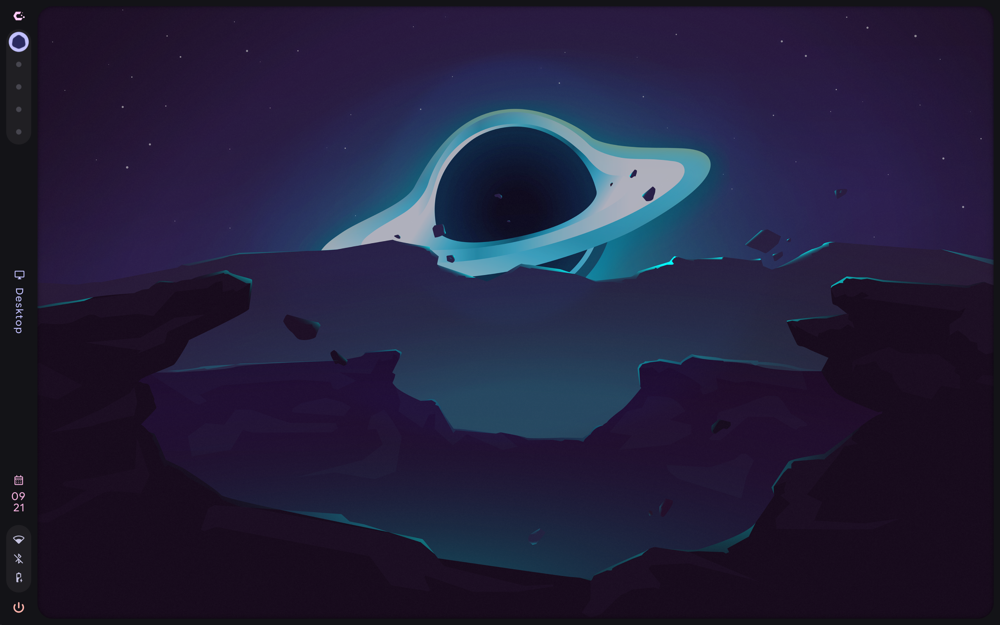
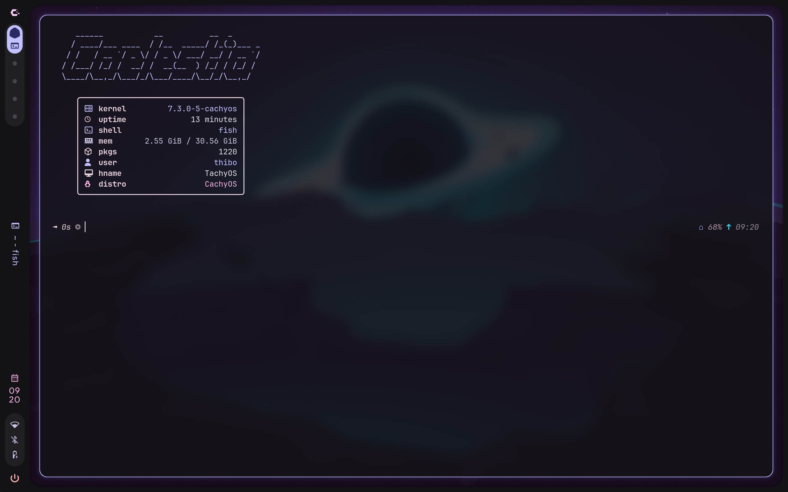

# Caelestia Shell

Caelestia is een shell voor Hyprland, gebouwd met Quickshell. Het bevat de taakbalk, launcher, meldingen, instellingen en andere grafische onderdelen. Het werkt op Arch-gebaseerde distributies, waaronder CachyOS.

**Geschatte duur:** 30 tot 60 minuten

**Benodigdheden:**
- Installatie voltooid met **No Desktop**
- Ethernetkabel

> [!NOTE]
> Deze guide gaat ervan uit dat je weet hoe je tekstbestanden kunt wijzigen met **nano**.

<div style="display:flex; gap:1rem; flex-wrap:wrap;">
  
  
</div>

## 1. Setup

- `sudo pacman -Syu`

Synchroniseert de pakketlijsten van het apparaat en werkt alle geïnstalleerde pakketten bij.

> [!IMPORTANT]
> Doe dit altijd eerst! Verouderde pakketten veroorzaken vaak conflicten of foutmeldingen tijdens een installatie.

- `sudo pacman -S hyprland`

Installeert Hyprland, de Wayland-compositor. Dat is het onderdeel dat vensters tekent en beheert. Caelestia draait hier bovenop.

- `sudo pacman -S --needed git base-devel`

Installeert de bouwtools (zoals make, gcc en fakeroot) die nodig zijn om AUR-pakketten zelf te compileren. `--needed` slaat pakketten over die al geïnstalleerd zijn.

## 2. AUR-helper installeren

De **AUR** (Arch User Repository) bevat pakketten die niet in de officiële repo’s staan. Om die makkelijk te installeren gebruik je een AUR-helper, zoals paru of yay. In deze guide gebruiken we paru.

- `paru --version`

Controleert of paru al geïnstalleerd is. Op CachyOS is dat meestal al het geval.

**Krijg je het versienummer te zien?**

Ja - Paru is al geïnstalleerd, en je kan de volgende stap overslaan.  

Neen - Paru is staat nog niet op je systeem en moet nog geïnstalleerd worden met:

- `sudo pacman -S paru`

Installeert paru als helper, zodat we voortaan via paru aan de AUR kunnen om paketten te installeren.

## 3. Caelestia installeren

Aangezien we geen desktopomgeving, terminal of shell geïnstalleerd hebben moeten ze dit zelf downloaden.

> [!NOTE]
> Als er meerdere kandidaten zijn, vraagt paru welk pakket je bedoelt. Meestal kies je de stabiele versies, dat zijn de versies zonder `-git` in de naam.

- `paru -S caelestia-cli`

Installeert de Caelestia-CLI (het beheercommando) uit de AUR.

```bash
:: There are 4 providers for caelestia-cli:
:: Repository AUR
    1) caelestia-cli
    2) caelestia-cli-git
    3) midnight-cli
    4) midnight-cli-git
```

Kies hier voor `caelestia-cli (1)`.

- `paru -S caelestia-shell`

Installeert de Caelestia-Shell zelf uit de AUR.

```bash
:: There are 2 providers for caelestia-shell:
:: Repository AUR
    1) caelestia-shell
    2) caelestia-shell-git
```

Kies hier voor `caelestia-shell (1)`.

- `caelestia install`

Installeert de Caelestia-dots: de configuratiebestanden en bijbehorende software.  
Tijdens dit commando krijg je meerdere vragen:

```bash
:: Backup directory config? [Y/n]
```

Typ hier `Y` of druk op `ENTER`, dit zet je bestaande configuratiemap eerst veilig opzij zodat er niets verloren gaat.

```bash
:: Components to enable:
    1) Spotify
    2) Discord
    3) Nvim
    4) Btop
    5) Zen
    6) ...
```

Hier kies je welke optionele onderdelen mee geïnstalleerd worden, door de nummers in te typen. De keuzes omvatten Spotify, Discord, Zen, ...

> [!IMPORTANT]
> Sommige pakketten kunnen mislukken, waardoor de hele installatie kan stoppen. Voer `caelesstia install` opnieuw uit en probeer je keuzes weer door te geven. Lukt dat niet? Kies dan geen enkele component en installeer ze later vanuit de desktopomgeving.

```bash
:: There are 2 providers available for libtree-sitter:
    1) cachyos-extra-znver4
    2) cachyos-extra
```

Kies hier voor `cachyos-extra-znver4 (1)` als je een AMD Zen 4/5-processor hebt (geen Intel of ARM).  
Als dat niet zo is, kies je `cachyos-extra (2)`.

```bash
:: There are 2 providers available for libunibilium:
    1) cachyos-extra-znver4
    2) cachyos-extra
```

Kies hier voor `cachyos-extra-znver4 (1)` als je een AMD Zen 4/5-processor hebt (geen Intel of ARM).  
Als dat niet zo is, kies je `cachyos-extra (2)`.

```bash
:: Pipewire-jack and Jack2 are in conflict. Remove Jack2? [y/N]
```

Beide leveren dezelfde functie, dus typ hier `Y` en druk op `ENTER` om `Jack2` te verwijderen.

```bash
:: There are 2 providers available for papirus-folders:
    1) papirus-folders
    2) papirus-folders-catppuccin-git
    3) ...

Enter a number (default=1):
```

Hier kies je het kleurenthema voor de Papirus-mapiconen. Kies voor `papirus-folders (1)` als je de standaardkleuren wilt, en `papirus-folders-catppuccin-git (2)` als je standaardkleuren en extra wilt.

```bash
:: There are 2 providers available for qtengine:
    1) qtengine
    2) qtengine-git

Enter a number (default=1):
```

De engine voor het thema en de kleuren van Qt-programma’s. Kies hier voor `qtengine (1)`.

```bash
:: There are 2 providers available for spotify:
    1) spotify
    2) spotify-git

Enter a number (default=1):
```

Kies voor `spotify (1)`, de normale versie van spotify.

```bash
:: Import PGP key? [Y/n]
```

Typ hier `Y` of druk op `ENTER`, zodat de sleutel geïmporteerd wordt en je het pakket kan installeren.

```bash
:: There are 2 providers available for spicetify:
    1) spicetify
    2) spicetify-cli

Enter a number (default=1):
```

Kies voor `spicetify-cli (2)`, een tool om Spotify te customisen.

## 4. Inlogscherm installeren

Omdat we alles zelf installeren, moeten we ook nog een inlogmanager installeren zodat we niet telkens via de **TTY** onze desktopomgeving hoeven op te starten. In deze workshop zullen we **SDDM** gebruiken, omdat deze een bijpassend thema bevat voor Caelestia.

- `sudo pacman -S sddm`

Installeert SDDM, de grafische loginmanager.

- `sudo systemctl enable sddm`

Laat **SDDM** bij elke boot automatisch opstarten. Zonder dit moet je Hyprland handmatig vanaf de **TTY** starten.

- `paru -Ss caelestia-sddm`

Zoekt naar de beschikbare Caelestia-SDDM-thema’s. Kies er daarna één naar eigen smaak (bijvoorbeeld **Locklike**, **Minimalist** of **MinimalistV2**)

- `paru -S caelestia-sddm-locklike-git`

Installeert het gekozen thema, volgens de stijl `caelestia-sddm-<themanaam>-git`, dit is dus afhankelijk van jouw keuze. Er kan maar één thema tegelijk geïnstalleerd zijn.

```bash
:: There are 2 providers available for qt6-multimedia-ffmpeg:
:: Repository AUR
    1) qt6-multimedia-ffmpeg
    2) qt6-multimedia-gstreamer

Enter a number (default=1):
```

Het thema heeft Qt6 Multimedia nodig, dus ga voor `qt6-multimedia-ffmpeg (1)`.

- `sudo mkdir -p /etc/sddm.conf.d`

Maakt de map aan die nodig is om **SDDM** te configureren.

- `sudo nano /etc/sddm.conf.d/caelestia.conf`

Opent het configuratiebestand voor **SDDM**, of maakt dat bestand aan als dat nog niet gebeurt was.

**Kun je onderstaande data terugvinden?**

```bash
[Theme]
Current=caelestia
```

Ja - de loginmanager is succesvol geïnstalleerd.  

Neen - de configuratie is nog niet voltooid, voeg de data zelf toe.

## 5. Afronden

- `sudo pacman -Syu`

Een laatste systeemupdate, zodat alles pakketten up-to-date zijn.

- `reboot`

Herstart de computer, zodat services zoals **SDDM** en **PipeWire** opnieuw starten. Kies op het inlogscherm de sessie **Hyprland**.

> [!WARNING]
> De desktopomgeving zal na het inloggen niet laden, en je zal een grijs/zwart scherm te zien krijgen door een bug. Druk op `Ctrl+Alt+F3` om **TTY3** te openen.

- `sudo nano /etc/xdg/quickshell/caelestia/shell.qml`

Opent het hoofdbestand van de shell. Verwijder hier alle `DefaultEnv` woorden in de eerste vijf regels, zodat er `Env` komt te staan. Druk op `Ctrl+Alt+F1 of F2` of om terug naar de grafische sessie te wisselen.

## 6. Later aanpassen

- `sudo /usr/share/sddm/themes/caelestia/scripts/sync.sh`

Kopieert je wallpaper en kleuren naar het inlogscherm, zodat het bij je desktop past.  
Draai dit opnieuw als je de wallpaper wijzigt.

- `nano ~/.config/caelestia/hypr-vars.lua`

Wijzig de variabelen voor je Hyprland-config, zoals standaardprogramma’s en instellingen.

- `nano ~/.config/caelestia/hypr-user.lua`

Wijzig je eigen aanpassingen die de standaardwaarden overschrijven.

- `nano ~/.config/hypr/hyprland.lua`

Wijzig de instellingen voor hyprland, zoals de resolutie, verversingssnelheid en schaal.

## 7. Problemen

Ervaar je toch problemen bij het installeren van deze guide, of heb je liever begeleiding? Kom langs in het **IT-lab**, waar er studenten zijn die je zullen helpen!
