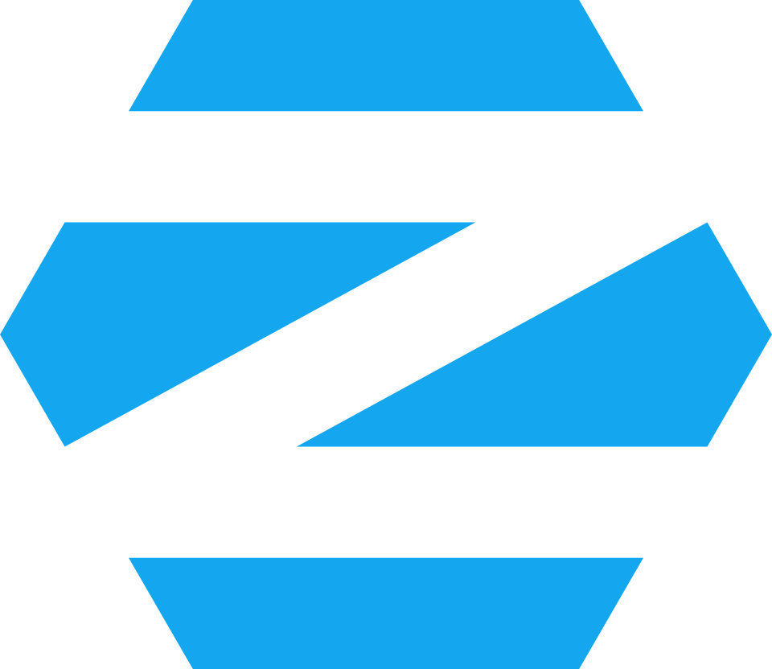
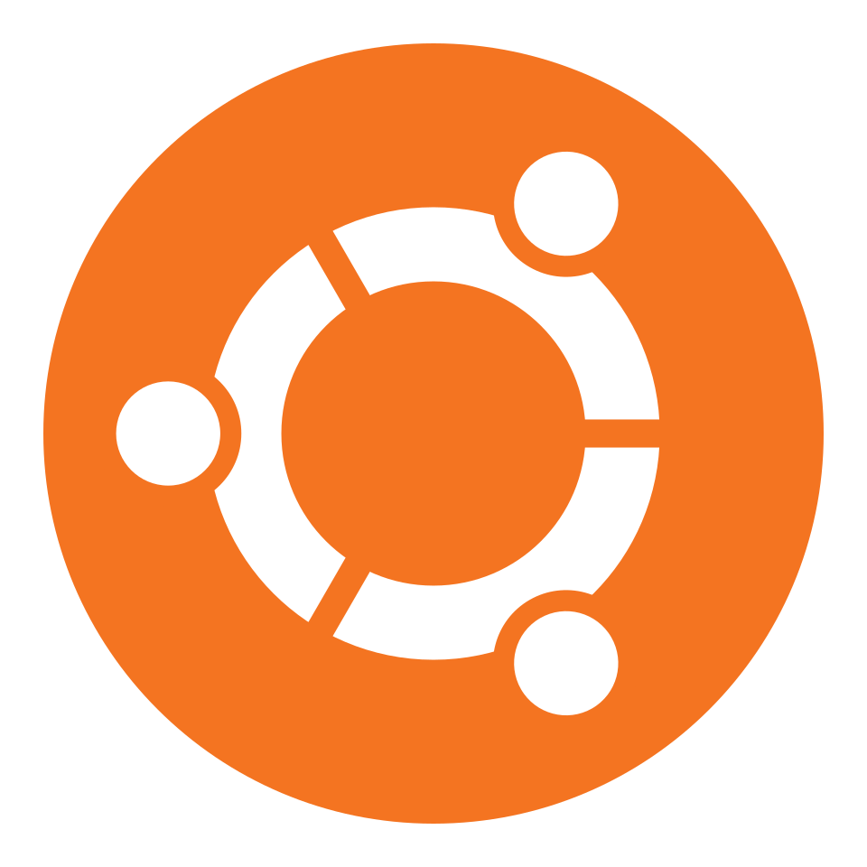
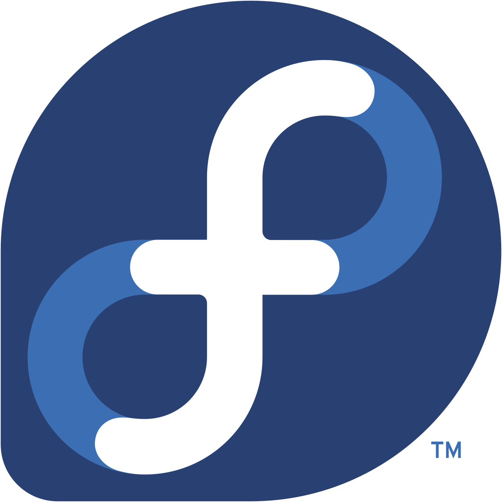
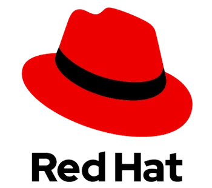
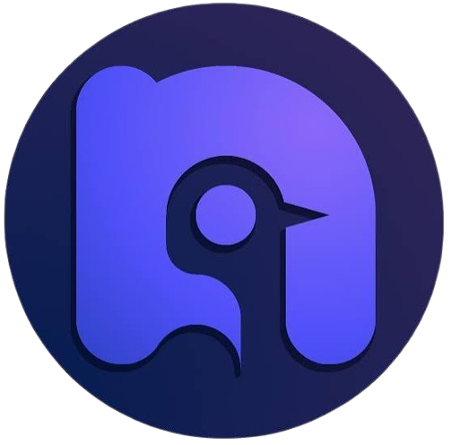
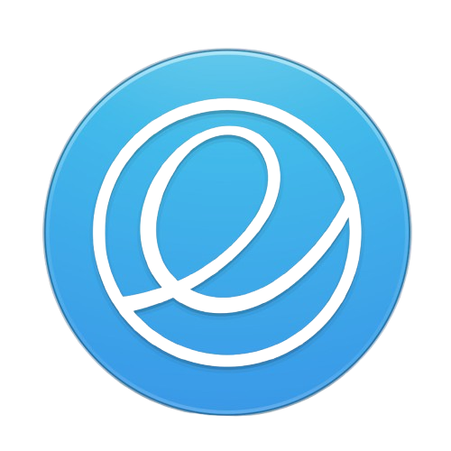

# Hoe kies ik mijn distributie?

Deze guide zal je helpen bij het kiezen van een geschikte distro voor jouw computer. Het aanbod is immens, en studenten worden vaak overweldigd door het aantal distributies die er zijn.

Om de keuze in OS te maken, moet je rekening houden met ontwerpcriteria. Helaas is het onmogelijk om aan alles te voldoen. Voor persoonlijk gebruik wil je liever een flexibel systeem, maar een bank zal liever voor een consistent systeem gaan.

### Consistentie

De respons van het OS moet voorspelbaar blijven.

- Als ik meerdere keren dezelfde opdracht doe, krijg ik dan steeds hetzelfde resultaat?
- Crasht mijn systeem (te) vaak?

### Flexibiliteit

Nieuwe versies van het OS mogen oude applicaties niet (vaak) breken.

- Wat kan mijn besturingssysteem aan en waarvoor is het bedoeld?
- Windows kan heel veel aan, maar Raspberry Pi niet.

### Overdraagbaarheid

Het OS moet op verschillende hardware kunnen draaien.

- Hoe gemakkelijk kan ik (data) wisselen tussen OS?

## Windows-gebruikers

Voor sommige mensen is de overstap naar Linux te groot, waardoor ze deze niet (volledig willen maken). Dit kan gemakkelijk verholpen worden, aangezien er distributies bestaan zoals Linux Mint en Zorin OS die extreem gebruiksvriendelijk zijn in zowel de installatie als de omgang, waardoor de stijle leercurve door het wisselen naar Linux geen probleem meer is. Deze besturingssystemen focussen zich op de GUI en gebruiken de terminal enkel waar nodig.

Hoewel de échte Linux-gebruikers toch liever hun skills tonen met moeilijkere distributies zijn Linux Mint en Zorin OS ook voor ervaren Linux-gebruikers geliefd: ze zijn simpel op te zetten en worden vaak gebruikt als substitutiemiddel voor Windows, maar dan efficiënter en beter.

### Linux Mint

Linux Mint is een gebruiksvriendelijke, stabiele distributie gebaseerd op Ubuntu (of Debian voor LMDE). Het staat bekend om zijn Cinnamon‑desktop, die sterk lijkt op de klassieke Windows‑interface.

- Interface: Klassiek Windows‑achtig (Cinnamon)
- Gebruiksgemak: Zeer eenvoudig, alles werkt direct
- Prestaties: Licht, vooral Xfce‑editie
- Softwarebeheer: APT + Flatpak, geen Snap
- Doelgroep: Gebruikers die stabiliteit en eenvoud willen

Kies Linux Mint als je een klassieke Windows‑ervaring, maximale stabiliteit en een no‑nonsense desktop wilt Mint is minder geschikt als je de nieuwste software en maximale aanpasbaarheid vraagt.

### Zorin OS

Zorin OS is een Ubuntu‑LTS‑gebaseerde distributie die expliciet ontworpen is om de overstap van Windows zo soepel mogelijk te maken. Het is geen experimentele Linux‑distro, maar een comfortabele, moderne en visueel gepolijste desktopomgeving.

- Interface: Modern Windows‑achtig (Zorin Desktop)
- Gebruiksgemak: Zeer eenvoudig, extra visuele polish
- Prestaties: Zeer licht, draait op oude pc’s
- Softwarebeheer: Ubuntu‑softwarewinkel + Flatpak
- Doelgroep: Windows‑overstappers die een moderne look willen

> [!NOTE]  
> Sommige functies zijn alleen beschikbaar in de betaalde editie (Zorin OS Pro). Deze vereist een eenmalige betaling om toegang te krijgen tot de professionele functies, maar de gratis versie is volstaat zeker!

Kies Zorin OS als je een moderne Windows‑look, Windows‑app‑compatibiliteit en een gepolijste interface belangrijk vindt.

## Stabiliteit

### Debian

Debian is een van de oudste en meest betrouwbare Linux‑distributies die vandaag nog actief ontwikkeld wordt. Het is volledig community‑gedreven en staat bekend om zijn stabiliteit, voorspelbaarheid en enorme software‑repositories.

- Interface: GNOME (klassiek, sober)
- Gebruiksgemak: Medium; technisch maar voorspelbaar
- Prestaties: Zeer stabiel, niet cutting‑edge
- Softwarebeheer: APT, point release
- Doelgroep: Servers, stabiele desktops

Je kiest Debian wanneer je stabiliteit, betrouwbaarheid en rust belangrijker vindt dan de nieuwste features. Het is ideaal voor systemen die gewoon moeten blijven werken: servers, homelabs, werkstations en minimalistische desktops.

### Ubuntu

Ubuntu is een van de meest gebruikte toegankelijke Linux‑distributies ter wereld. Het is gebouwd op Debian, maar richt zich veel sterker op gebruiksgemak, moderne desktopervaring en brede hardware‑ondersteuning.

- Interface: GNOME met Ubuntu‑shell
- Gebruiksgemak: Zeer eenvoudig, veel automatisatie
- Prestaties: Goed voor workloads, gaming is oké
- Softwarebeheer: APT + Snap, LTS + tussenreleases
- Doelgroep: Beginners, mainstream gebruikers

Je kiest Ubuntu wanneer je een stabiele, moderne en gebruiksvriendelijke Linux‑ervaring wilt zonder gedoe. Het is ideaal voor beginners dankzij de automatische hardwaredetectie, duidelijke instellingen en enorme community.

### Fedora

Fedora is een moderne, vooruitstrevende Linux‑distributie die zich richt op nieuwe technologie, innovatie en een pure GNOME‑ervaring. Het wordt ontwikkeld door de community met ondersteuning van Red Hat, en fungeert vaak als de plek waar nieuwe Linux‑technologieën eerst verschijnen voordat ze later in enterprise‑systemen terechtkomen.

- Interface: GNOME (stock, modern)
- Gebruiksgemak: Medium; technisch maar logisch
- Prestaties: Cutting‑edge, zeer goed voor workloads
- Softwarebeheer: DNF, semi‑rolling
- Doelgroep: Developers, power users

Je kiest Fedora wanneer je een moderne, snelle en cutting‑edge Linux‑ervaring wilt die toch stabiel genoeg is voor dagelijks gebruik. Fedora is ideaal voor developers, power users en iedereen die graag werkt met de nieuwste technologieën zoals Wayland, nieuwe kernels, moderne GNOME‑versies en container‑tools.

## Servers

### openSUSE

openSUSE is een professionele, veelzijdige Linux‑distributie die wordt ontwikkeld door de openSUSE‑community in samenwerking met SUSE, een grote enterprise‑speler. Het bestaat in twee varianten: Leap (stabiel, enterprise‑basis) en Tumbleweed (rolling release, altijd up‑to‑date).

(Leap)

- Interface: KDE Plasma standaard
- Gebruiksgemak: Medium; YaST helpt veel
- Prestaties: Zeer goed; rolling release
- Softwarebeheer: Zypper, rolling
- Doelgroep: Power users, sysadmins

(Tumbleweed)

- Interface: KDE Plasma standaard
- Gebruiksgemak: Medium; enterprise‑gevoel
- Prestaties: Zeer stabiel, voorspelbaar
- Softwarebeheer: Zypper, point release
- Doelgroep: Enterprise, stabiele desktops

Je kiest openSUSE wanneer je een krachtige, professionele en flexibel inzetbare Linux‑distributie wilt.
Leap is ideaal voor gebruikers die een stabiele, enterprise‑achtige basis willen zonder de complexiteit van RHEL.

Tumbleweed is perfect voor wie een rolling release wil die toch betrouwbaar blijft dankzij strenge kwaliteitscontroles.

### RHEL (Red Hat Enterprise Linux)

RHEL is een enterprise‑gerichte Linux‑distributie ontwikkeld door Red Hat, een van de grootste en meest invloedrijke bedrijven in de open‑sourcewereld. Het is ontworpen voor bedrijven, organisaties en productieomgevingen waar stabiliteit, veiligheid, voorspelbaarheid en professionele ondersteuning cruciaal zijn.

- Interface: GNOME (enterprise‑stijl)
- Gebruiksgemak: Medium; professioneel, minder desktopgericht
- Prestaties: Zeer stabiel, niet cutting‑edge
- Softwarebeheer: DNF, point release
- Doelgroep: Bedrijven, productieomgevingen

Je kiest RHEL wanneer je een professioneel, stabiel en langdurig ondersteund Linux‑platform nodig hebt dat geschikt is voor bedrijfsomgevingen.

## Gaming

### Bazzite

Bazzite is een moderne, gaming‑gerichte Linux‑distributie gebouwd bovenop Fedora’s immutable technologie (rpm‑ostree). Het is ontworpen om een ervaring te bieden die sterk lijkt op SteamOS, maar dan geschikt voor gewone pc’s, laptops, HTPC’s en zelfs de Steam Deck.

- Interface: KDE (SteamOS‑achtig)
- Gebruiksgemak: Zeer eenvoudig voor gamers
- Prestaties: Zeer hoog; volledig gaming‑geoptimaliseerd
- Softwarebeheer: rpm‑ostree, immutable rolling
- Doelgroep: Gamers, Steam Deck/HTPC

Je kiest Bazzite wanneer je een SteamOS‑achtige ervaring wilt op hardware die geen Steam Deck is. Het is ideaal voor gamers die maximale prestaties willen zonder zelf te moeten sleutelen aan kernels, drivers, Proton‑versies of game‑optimisaties.

### Nobara

Nobara is een gaming‑gerichte Linux‑distributie gebouwd bovenop Fedora, maar dan met alle optimalisaties die gamers normaal zelf moeten installeren al vooraf geïntegreerd. In plaats van een “pure” Fedora‑ervaring krijg je een kant‑en‑klare gaming‑setup met aangepaste kernels, extra repositories, verbeterde compatibiliteit en tools die direct klaarstaan voor Steam, Lutris, Heroic, emulators en streamingsoftware.

- Interface: GNOME of KDE
- Gebruiksgemak: Zeer eenvoudig voor gaming/streaming
- Prestaties: Zeer hoog; custom kernels, NVIDIA‑fixes
- Softwarebeheer: DNF, semi‑rolling
- Doelgroep: Gamers, streamers

Je kiest Nobara wanneer je een gebruiksvriendelijke, krachtige en volledig geoptimaliseerde gaming‑ervaring wilt zonder dat je zelf moet sleutelen aan drivers, kernels of compatibiliteitslagen.

### POP!\_OS

Pop!\_OS is een gebruiksvriendelijke, moderne Linux‑distributie ontwikkeld door System76. Het is gebaseerd op Ubuntu, maar richt zich veel sterker op productiviteit, creators, developers en NVIDIA‑gebruikers.

- Interface: COSMIC (GNOME‑afgeleide)
- Gebruiksgemak: Zeer eenvoudig, productief
- Prestaties: Goed; NVIDIA‑vriendelijk
- Softwarebeheer: APT + Flatpak, Ubuntu LTS
- Doelgroep: Creators, developers

Je kiest Pop!\_OS wanneer je een moderne, productieve en hardware‑vriendelijke Linux‑ervaring wilt die minder rommelig is dan Ubuntu en meer gericht is op efficiënt werken.

## Prestaties en customisation

### Arch Linux

Arch Linux is een minimalistische, rolling‑release Linux‑distributie die je volledig zelf opbouwt. Het levert een extreem lichte basis zonder overbodige software, zodat je precies kunt installeren wat je nodig hebt.

- Interface: Geen standaard (DIY)
- Gebruiksgemak: Laag; alles handmatig
- Prestaties: Zeer hoog; cutting‑edge
- Softwarebeheer: Pacman + AUR, rolling
- Doelgroep: Power users, tweakers

Je kiest Arch wanneer je volledige controle, maximale flexibiliteit en de nieuwste software wilt. Arch is ideaal voor power users die hun systeem precies willen begrijpen en configureren.

### CachyOS

CachyOS is een Arch‑gebaseerde distributie die zich richt op maximale prestaties, vooral voor gaming en desktopgebruik. Het combineert de flexibiliteit van Arch met automatische optimalisaties zoals geavanceerde CPU‑schedulers, geoptimaliseerde kernels, prestatieprofielen en een gebruiksvriendelijke installer.

> [!TIP]  
> Er zijn een aantal Studenten in het IT-lab die CachyOS als daily driver gebruiken op hun computer. Als je hulp nodig hebt bij de installatie, kun je hen zeker opzoeken!

- Interface: KDE Plasma (Variabel)
- Gebruiksgemak: Medium; installer helpt veel
- Prestaties: Zeer hoog; performance kernels, gaming
- Softwarebeheer: Pacman + AUR, rolling
- Doelgroep: Gamers, performance‑liefhebbers

Je kiest CachyOS wanneer je Arch‑flexibiliteit wilt zonder Arch‑moeilijkheid, gecombineerd met topprestaties voor gaming en desktopgebruik.

### NixOS

NixOS is een unieke Linux‑distributie die volledig draait rond declaratieve configuratie en de Nix‑package‑manager. In plaats van handmatig instellingen te wijzigen, beschrijf je je hele systeem in één configuratiebestand.

- Interface: Geen standaard (DIY)
- Gebruiksgemak: Laag‑medium; declaratief denken vereist
- Prestaties: Hoog; reproduceerbaar en stabiel
- Softwarebeheer: Nix, declaratief, rolling
- Doelgroep: DevOps, configuratie‑experts

Je kiest NixOS wanneer je volledige controle, reproduceerbaarheid en veiligheid wilt.
Het is ideaal voor developers, sysadmins en power users die hun systeem willen beheren als code.

### Gentoo Linux

Gentoo is een broncode‑gebaseerde Linux‑distributie waarbij je vrijwel alle software zelf compileert. Hierdoor kun je je systeem volledig optimaliseren voor jouw hardware en jouw wensen.

- Interface: Geen standaard (DIY)
- Gebruiksgemak: Laag; compile‑gebaseerd
- Prestaties: Zeer hoog; volledig geoptimaliseerd
- Softwarebeheer: Portage, rolling
- Doelgroep: Experts, performance‑puristen

Je kiest Gentoo wanneer je absolute controle en maximale optimalisatie wilt. Gentoo laat je je systeem precies bouwen zoals jij het wilt, geoptimaliseerd voor jouw CPU, jouw hardware en jouw functionaliteit.

## Design en pracht

### Deepin

Deepin is een Chinese Linux‑distributie die bekendstaat om zijn zeer moderne, visueel indrukwekkende en gebruiksvriendelijke desktopomgeving: de Deepin Desktop Environment (DDE).

- Interface: Deepin Desktop (macOS‑achtig)
- Gebruiksgemak: Hoog; visueel intuïtief
- Prestaties: Medium; visueel zwaar
- Softwarebeheer: APT, Debian‑basis
- Doelgroep: Beginners, visuele gebruikers

Je kiest Deepin wanneer je een prachtige, moderne en zeer gebruiksvriendelijke desktop wilt die meteen goed aanvoelt zonder dat je iets hoeft te tweaken.

### Elementary OS

Elementary OS is een elegante, minimalistische Linux‑distributie gebaseerd op Ubuntu, ontworpen om een rustige, consistente en macOS‑achtige gebruikerservaring te bieden.

- Interface: Pantheon (macOS‑achtig)
- Gebruiksgemak: Hoog; minimalistisch en rustig
- Prestaties: Medium; lichte desktop
- Softwarebeheer: APT, Ubuntu LTS
- Doelgroep: Minimalisten, macOS‑fans

Je kiest Elementary OS wanneer je een minimalistische, rustige en visueel consistente desktop wilt die niet vol staat met opties of afleiding. Het is ideaal voor gebruikers die een macOS‑achtige workflow willen, maar dan op Linux en zonder complexe configuratie.
